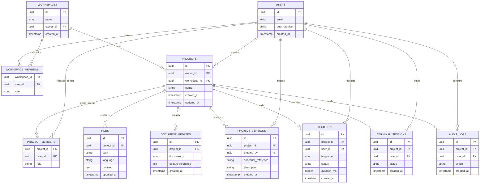
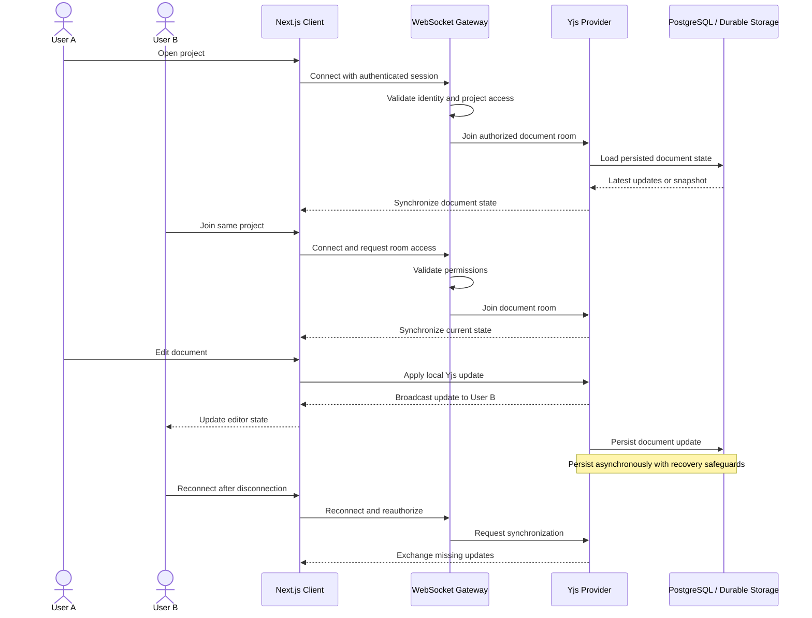
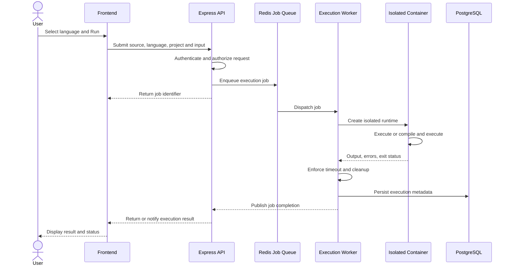
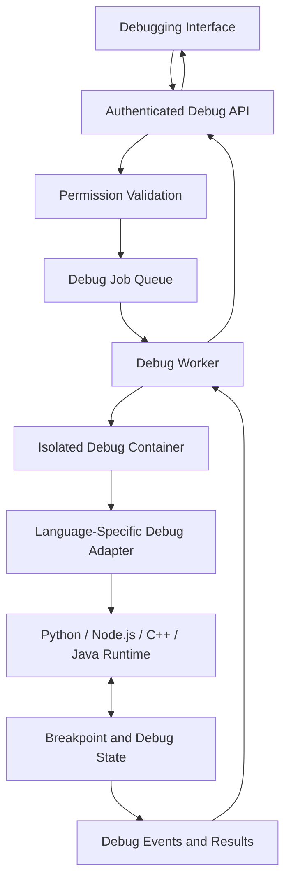
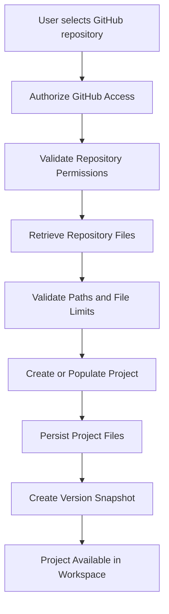
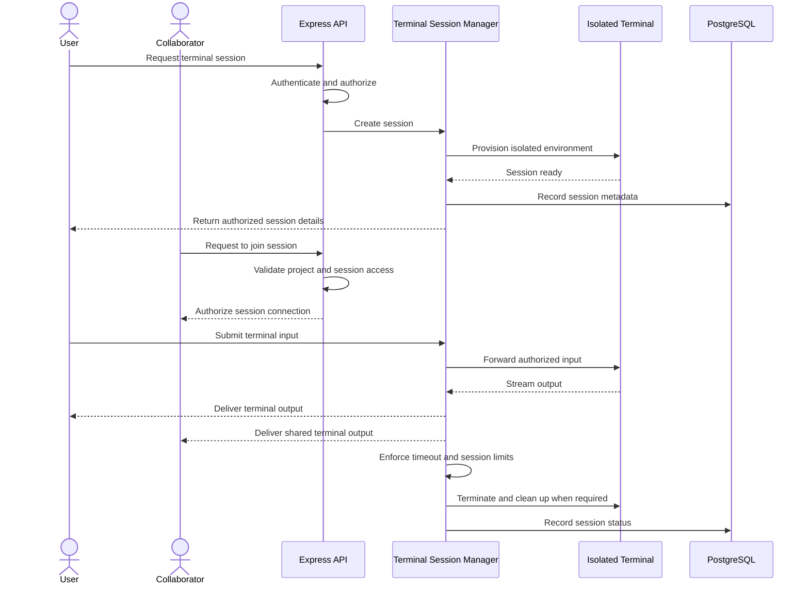
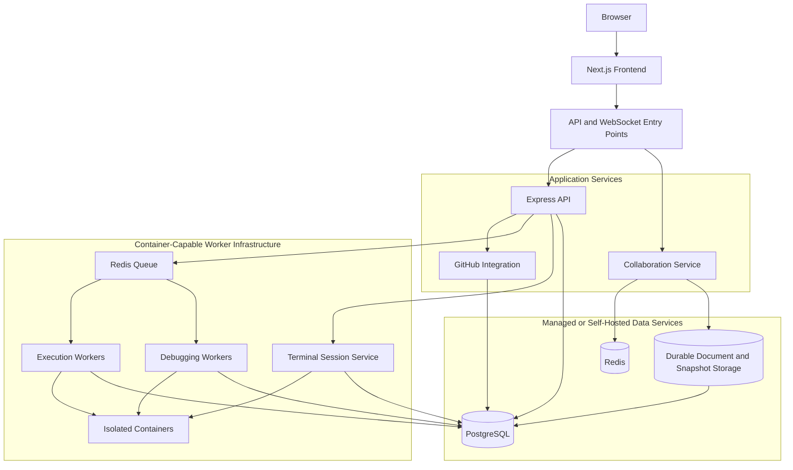

# System Architecture
## Real-Time Collaborative Code Editor

**Version:** 2.0  
**Status:** Architecture Specification  
**Based on:** Product Requirements Document (PRD) v2.0  
**Architecture Style:** Modular, event-driven, service-oriented architecture

---

## 1. Architecture Overview

The Real-Time Collaborative Code Editor is a browser-based development platform designed for simultaneous code editing, secure execution, debugging, repository import, and team collaboration.

The architecture separates the application into the following logical layers:

1. **Presentation Layer:** User interface, Monaco Editor, terminal, debugging controls, and dashboards.
2. **Application Layer:** Authentication, project management, workspace permissions, GitHub integration, version management, and analytics APIs.
3. **Collaboration Layer:** WebSocket connections, Yjs synchronization, presence, and collaborative document persistence.
4. **Execution Layer:** Isolated code execution workers, debugging workers, and collaborative terminal environments.
5. **Data Layer:** PostgreSQL, durable document updates, project snapshots, and Redis-backed messaging and job queues.
6. **Infrastructure and Security Layer:** Authentication enforcement, resource isolation, monitoring, audit logging, and deployment management.

The architecture ensures that untrusted code runs separately from the API and collaboration services.

## 2. High-Level System Architecture

The following diagram shows the primary components and their relationships.

```mermaid
flowchart TB
    U["Users and Collaborators"]

    subgraph CLIENT["Presentation Layer"]
        WEB["Next.js Web Application"]
        EDITOR["Monaco Code Editor"]
        FILES["Project Explorer"]
        DEBUG_UI["Debugging Interface"]
        TERM_UI["Collaborative Terminal UI"]
        DASH["Execution Analytics Dashboard"]
    end

    subgraph APP["Application Layer"]
        API["Node.js Express API"]
        AUTH["Authentication Service"]
        PROJECT["Project and File Service"]
        TEAM["Workspace and Permission Service"]
        GITHUB["GitHub Integration Service"]
        VERSION["Version History Service"]
        ANALYTICS["Execution History and Analytics API"]
    end

    subgraph COLLAB["Collaboration Layer"]
        WS["WebSocket Gateway"]
        YJS["Yjs Collaboration Provider"]
        AWARE["Yjs Awareness and Presence"]
        DOCSTORE["Document Persistence Service"]
    end

    subgraph EXEC["Isolated Execution Layer"]
        QUEUE["Redis-Backed Job Queue"]
        EXECUTOR["Execution Worker"]
        DEBUGGER["Debugging Worker"]
        TERMINAL["Terminal Session Manager"]
        SANDBOX["Isolated Execution Containers"]
    end

    subgraph DATA["Data Layer"]
        DB[("PostgreSQL")]
        REDIS[("Redis")]
        SNAP["Document Snapshots and Version History"]
        LOGS["Execution Records and Audit Logs"]
    end

    subgraph EXTERNAL["External Services"]
        GH["GitHub API"]
    end

    U --> WEB
    WEB --> EDITOR
    WEB --> FILES
    WEB --> DEBUG_UI
    WEB --> TERM_UI
    WEB --> DASH

    WEB -->|"HTTPS / REST"| API
    WEB <-->|"WebSocket"| WS

    API --> AUTH
    API --> PROJECT
    API --> TEAM
    API --> GITHUB
    API --> VERSION
    API --> ANALYTICS

    WS --> YJS
    YJS --> AWARE
    YJS --> DOCSTORE
    DOCSTORE --> DB
    DOCSTORE --> SNAP

    AUTH --> DB
    PROJECT --> DB
    TEAM --> DB
    VERSION --> DB
    VERSION --> SNAP
    ANALYTICS --> DB

    GITHUB <-->|"Authorized API calls"| GH
    GITHUB --> PROJECT

    API -->|"Authorized execution request"| QUEUE
    QUEUE --> EXECUTOR
    QUEUE --> DEBUGGER

    EXECUTOR --> SANDBOX
    DEBUGGER --> SANDBOX
    TERMINAL --> SANDBOX
    API --> TERMINAL

    EXECUTOR --> LOGS
    DEBUGGER --> LOGS
    TERMINAL --> LOGS
    LOGS --> DB

    WS -.->|"Cross-instance coordination"| REDIS
    QUEUE --> REDIS

    classDef client fill:#dbeafe,stroke:#2563eb,color:#111827
    classDef application fill:#dcfce7,stroke:#16a34a,color:#111827
    classDef collaboration fill:#f3e8ff,stroke:#9333ea,color:#111827
    classDef execution fill:#ffedd5,stroke:#ea580c,color:#111827
    classDef data fill:#f3f4f6,stroke:#6b7280,color:#111827

    class WEB,EDITOR,FILES,DEBUG_UI,TERM_UI,DASH client
    class API,AUTH,PROJECT,TEAM,GITHUB,VERSION,ANALYTICS application
    class WS,YJS,AWARE,DOCSTORE collaboration
    class QUEUE,EXECUTOR,DEBUGGER,TERMINAL,SANDBOX execution
    class DB,REDIS,SNAP,LOGS data
```



**Architecture principle:** PostgreSQL and durable document storage preserve application state. Redis supports transient coordination and queued jobs; it is not the permanent source of collaborative document truth.

## 3. Component Responsibilities

### 3.1 Presentation Layer

**Technology:** Next.js, TypeScript, Tailwind CSS, Monaco Editor.

Responsibilities:

- Provide registration, login, and project management interfaces.
- Display the multi-file editor and syntax highlighting.
- Show collaborator cursors, selections, and online presence.
- Provide execution controls and output panels.
- Expose debugging controls supported by configured runtimes.
- Display terminal sessions and project version history.
- Provide GitHub repository import workflows.
- Display workspace membership, permissions, and execution analytics.

The frontend must never be treated as the authority for permissions or execution security.

### 3.2 Application API Layer

**Technology:** Node.js and Express.

The API is responsible for:

- Authentication and session validation.
- Project and file management.
- Workspace membership and role-based access control.
- GitHub authorization and repository import.
- Project version creation and restoration.
- Execution and debugging job submission.
- Terminal session authorization.
- Execution history, analytics, and audit records.

The API validates project permissions before protected operations. Long-running execution tasks are delegated to workers rather than performed inside API request handlers.

### 3.3 Collaboration Layer

**Technology:** Yjs, WebSockets, Yjs Awareness, Hocuspocus or a custom Yjs-compatible provider.

Responsibilities:

- Maintain collaborative document sessions.
- Exchange incremental Yjs document updates.
- Broadcast cursor positions, selections, and presence information.
- Authenticate WebSocket connections and authorize room membership.
- Recover documents using durable updates or snapshots.
- Coordinate synchronization across multiple server instances.

Presence information is temporary and should not be treated as durable project data.

### 3.4 Execution and Debugging Layer

**Technology:** Docker-based isolated workers, language runtimes, Redis-backed queue.

Responsibilities:

- Execute Python, JavaScript, C++, and Java programs.
- Compile C++ and Java programs before execution.
- Support standard input, output, and error reporting.
- Execute debugging sessions through language-specific debugging adapters.
- Apply configurable CPU, memory, process, disk, timeout, and output limits.
- Terminate expired or unauthorized jobs.
- Record execution status and relevant metrics.

Each job must execute within an isolated environment. API and collaboration processes must never execute arbitrary user code directly.

### 3.5 Collaborative Terminal Layer

The terminal session manager creates and controls isolated terminal environments.

Responsibilities:

- Authenticate users joining a terminal session.
- Associate terminal sessions with a project and authorized collaborators.
- Stream terminal input and output through a controlled channel.
- Enforce session timeouts and resource limits.
- Define how simultaneous input is handled.
- Terminate idle or expired sessions.
- Prevent access to the host filesystem, host credentials, and Docker socket.

A collaborative terminal is a controlled project environment, not unrestricted access to the server's operating system.

### 3.6 GitHub Integration Layer

Responsibilities:

- Authorize users to access selected repositories.
- Retrieve repository files through the GitHub API.
- Validate imported file paths and file sizes.
- Preserve directory structure during import.
- Report import status and failures.
- Avoid exposing GitHub credentials to the frontend or executed code.

The initial release supports repository import. Bidirectional synchronization and advanced Git workflows are not assumed unless separately implemented.

## 4. Database Architecture

**Primary database:** PostgreSQL  
**Messaging and queue infrastructure:** Redis  
**Collaborative document engine:** Yjs

The following entity model is a proposed logical schema. Exact columns, indexes, and constraints should be finalized during database design.



### Database design notes

- `FILES.content` is a logical representation; implementation may store content separately from metadata to avoid conflicting writes with Yjs.
- `DOCUMENT_UPDATES.update_reference` represents a logical reference to durable Yjs update storage, not necessarily a text field containing serialized updates.
- `PROJECT_VERSIONS.snapshot_reference` identifies a durable snapshot or version artifact.
- Execution records should reference securely stored output only when retention and privacy policies allow it.
- Workspace and project membership tables must enforce role-based permissions.
- Database transactions should protect critical operations such as project creation and version restoration.

## 5. Real-Time Collaboration Workflow



### Collaboration guarantees

- Local edits should appear immediately.
- Concurrent changes must converge through Yjs synchronization.
- Reconnecting users must exchange missing document updates.
- Document persistence must survive service restarts.
- WebSocket room access must be authorized on the server.
- Presence events may be ephemeral, while document updates must be durable.

## 6. Code Execution Workflow



### Execution security controls

- Validate source size, language, project permissions, and job parameters.
- Run code only in disposable, isolated execution environments.
- Disable outbound networking by default.
- Apply CPU, memory, process, disk, execution-time, and output limits.
- Prevent executed programs from accessing production credentials.
- Clean up temporary files and terminated containers.
- Limit job submissions and queue consumption per user or project.

The implementation must also define how job status and output are delivered to the client, including polling or an authenticated streaming channel.

## 7. Debugging Architecture



The debugging layer should use runtime-specific adapters rather than assuming identical debugger behavior across all languages.

The debugging service must support the operations exposed by each configured adapter and must enforce the same isolation and resource controls as normal execution.

## 8. GitHub Import and Version History Workflow



### Version restoration workflow

1. The user selects a previous project version.
2. The backend verifies restoration permissions.
3. The system retrieves the requested snapshot.
4. The system validates the snapshot and creates a recovery point for the current state.
5. The system restores the project files and corresponding collaborative document state consistently.
6. The system records the restoration action in the audit log.
7. Connected collaborators receive the updated document state.

Restoration must be designed as a controlled state transition rather than a sequence of unrelated file overwrites.

## 9. Collaborative Terminal Workflow



Terminal access requires separate authorization from ordinary project editing. A user allowed to view code is not automatically authorized to execute terminal commands.

## 10. Team Permissions and Authorization

The backend must enforce permissions across REST APIs, WebSockets, execution jobs, debugging sessions, terminal sessions, GitHub operations, and version restoration.

A proposed initial role model is:

| Capability | Owner | Admin | Editor | Viewer |
|---|---|---|---|---|
| View project | Yes | Yes | Yes | Yes |
| Edit files | Yes | Yes | Yes | No |
| Execute code | Yes | Yes | Yes | No |
| Start debugging | Yes | Yes | Yes | No |
| Access terminal | Yes | Yes | Policy-controlled | No |
| Import repository | Yes | Policy-controlled | Policy-controlled | No |
| Restore versions | Yes | Policy-controlled | No | No |
| Manage members | Yes | Policy-controlled | No | No |
| Delete project | Yes | Policy-controlled | No | No |

The exact permissions assigned to Admin and Editor roles must be configurable and enforced consistently by the backend.

Workspace membership does not automatically grant unrestricted access to every project. Project-level access rules must also be checked.

## 11. Execution Analytics and Observability

The analytics service consumes execution records and relevant operational metrics.

The dashboard should display:

- Total execution requests.
- Successful and failed executions.
- Execution duration and trends.
- Compilation failures and timeout counts.
- Activity grouped by project, language, and time range.
- Relevant queue and worker health metrics for authorized administrators.

### Operational signals

| Area | Metrics |
|---|---|
| Collaboration | Active connections, synchronization latency, reconnects |
| API | Request latency, error rate, authentication failures |
| Execution | Job duration, timeout count, worker failures |
| Queue | Queue depth, waiting time, failed jobs |
| Database | Query latency, connection usage, persistence failures |
| Terminal | Active sessions, session duration, cleanup failures |
| Security | Authorization denials, rate-limit events, sensitive actions |

Logs and metrics must not expose secrets, access tokens, or unnecessary user code.

## 12. Deployment Architecture

The deployment environment must support persistent application services, WebSockets, PostgreSQL, Redis, and container-based execution workers.



### Deployment requirements

- The frontend can be deployed to a web hosting platform that supports Next.js.
- The API and collaboration services require suitable long-running service and WebSocket support.
- Execution, debugging, and terminal services require container-capable infrastructure with enforceable isolation.
- PostgreSQL must provide durable storage and backups appropriate to the deployment.
- Redis must be available to services that require queues or cross-instance coordination.
- Secrets must be supplied through secure environment configuration.
- Health checks, logging, monitoring, and controlled service shutdown must be implemented.

A serverless frontend hosting platform must not be assumed to provide Docker execution or persistent WebSocket services. These capabilities may need separate backend and worker deployments.

## 13. Suggested Repository Structure

```text
collaborative-code-editor/
├── frontend/
│   ├── app/
│   ├── components/
│   │   ├── editor/
│   │   ├── collaboration/
│   │   ├── debugging/
│   │   ├── terminal/
│   │   ├── versions/
│   │   └── analytics/
│   ├── hooks/
│   └── lib/
│
├── backend/
│   ├── src/
│   │   ├── api/
│   │   ├── auth/
│   │   ├── projects/
│   │   ├── workspaces/
│   │   ├── collaboration/
│   │   ├── github/
│   │   ├── versions/
│   │   ├── executions/
│   │   ├── debugging/
│   │   ├── terminal/
│   │   ├── analytics/
│   │   ├── permissions/
│   │   └── audit/
│   └── tests/
│
├── workers/
│   ├── execution/
│   ├── debugging/
│   └── terminal/
│
├── packages/
│   ├── shared-types/
│   └── validation/
│
├── database/
│   ├── migrations/
│   └── schema/
│
├── infrastructure/
│   ├── docker/
│   ├── deployment/
│   └── monitoring/
│
├── docs/
│   ├── PRD.md
│   └── SYSTEM_ARCHITECTURE.md
│
└── README.md
```

This is a suggested logical organization, not a requirement to deploy every directory as a separate service. Related modules may share a deployable service in the initial implementation.

## 14. Architecture Decisions and Constraints

1. **Yjs for collaboration:** Provides CRDT-based document synchronization and convergence.
2. **PostgreSQL for durable application state:** Stores project metadata, permissions, execution history, and version metadata.
3. **Redis for transient coordination:** Supports job queues and cross-instance messaging, not permanent document storage.
4. **Isolated workers for untrusted code:** Separates execution from the API and collaboration services.
5. **Language-specific debugging:** Debugging capabilities depend on the configured runtime and adapter.
6. **Role-based authorization:** Backend checks are required for every protected operation.
7. **Snapshot-based version history:** Project rollback must preserve a recoverable prior state.
8. **Controlled terminal sessions:** Terminal environments require isolation, authorization, and cleanup.
9. **Modular implementation:** Services should be independently testable, with separate deployment introduced where justified.
10. **Incremental security validation:** Execution, debugging, and terminal isolation must be verified before exposing these capabilities to untrusted users.

## 15. Implementation Phases

| Phase | Scope | Completion Goal |
|---|---|---|
| Phase 1 | Authentication, projects, file management, editor | Users can create and manage projects |
| Phase 2 | Yjs collaboration, WebSockets, persistence | Concurrent editing and recovery work |
| Phase 3 | Four-language execution and sandboxing | Secure execution is verified |
| Phase 4 | GitHub import and version history | Import and rollback work reliably |
| Phase 5 | Integrated debugging and collaborative terminal | Runtime tooling and terminal isolation pass tests |
| Phase 6 | Teams, permissions, analytics, observability | Access control and operational visibility are complete |
| Phase 7 | Integration, security, load, and recovery testing | Initial release acceptance criteria are satisfied |

Phases may overlap where dependencies permit, but sandbox security and authorization must be validated before execution and terminal functionality are exposed.

## 16. Conclusion

This architecture provides a modular foundation for a real-time collaborative development environment. It combines collaborative editing, secure multi-language execution, debugging, GitHub integration, version history, team workspaces, collaborative terminals, and operational analytics.

The design prioritizes document consistency, durable persistence, strict authorization, isolated execution, and maintainability. Implementation should proceed incrementally, with automated integration and security testing validating each subsystem against PRD v2.0.

---

**End of System Architecture Document**
