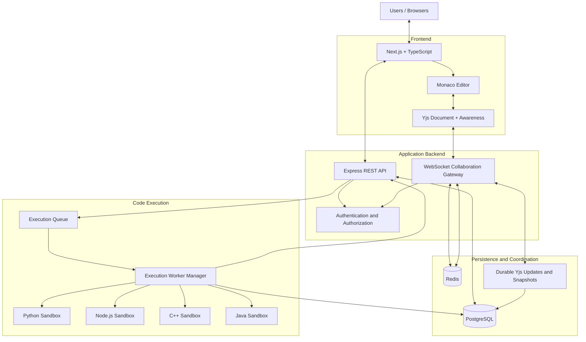
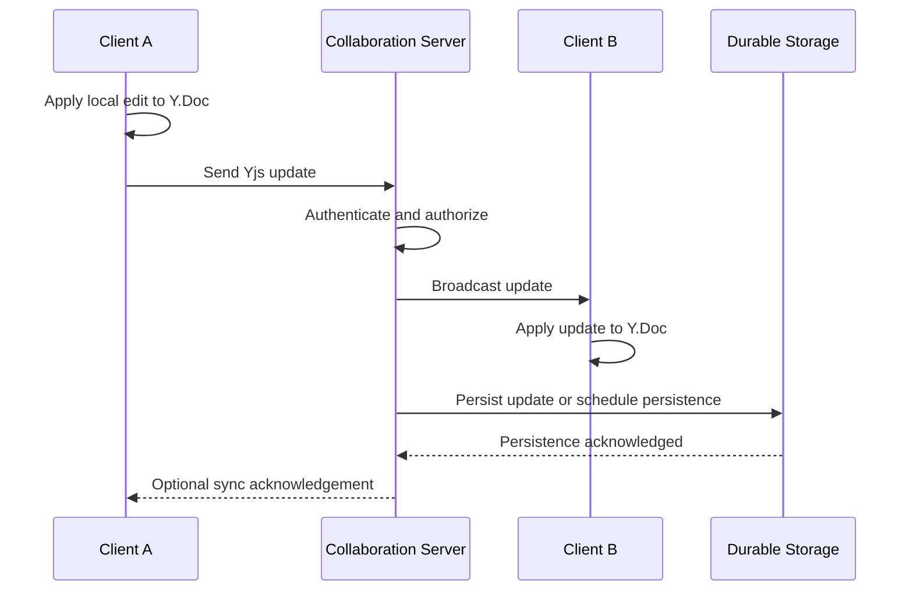
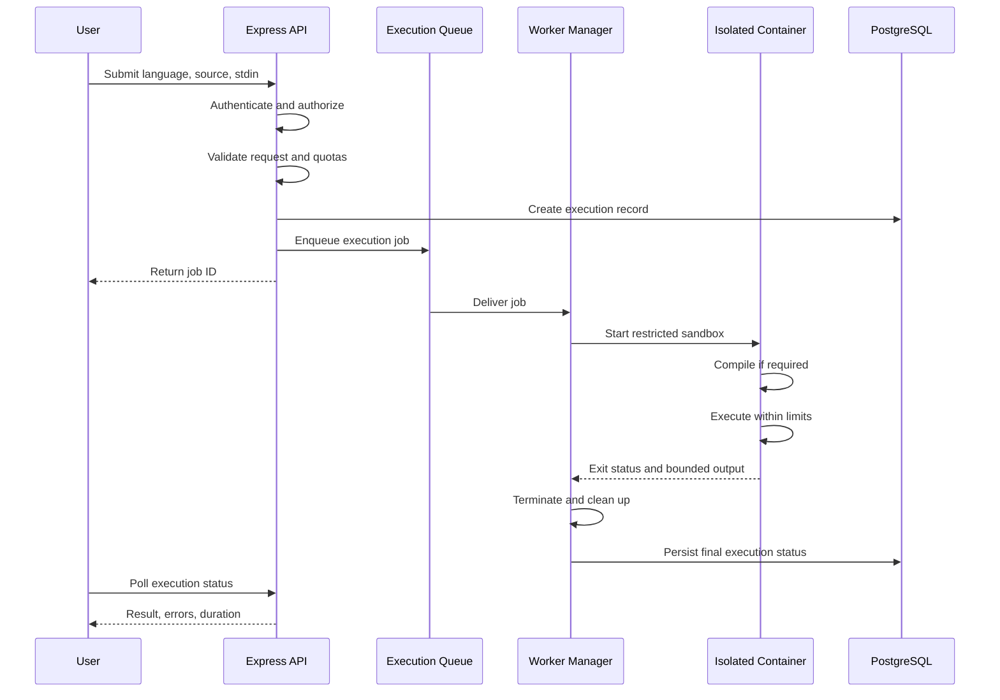
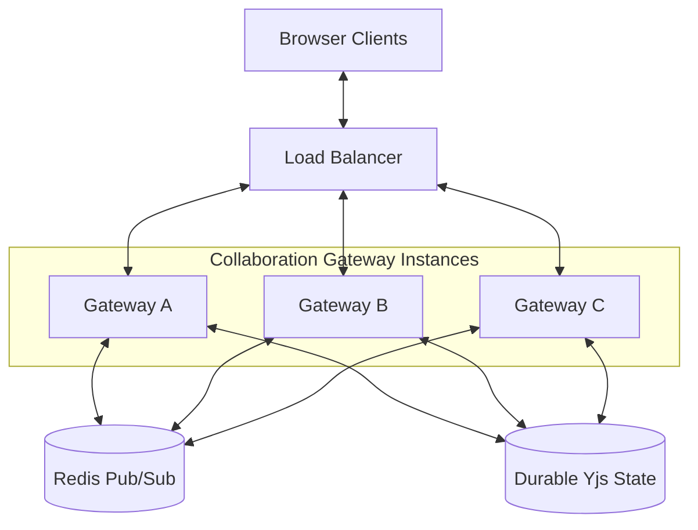

# System Architecture
## Real-Time Collaborative Code Editor

**Version:** 1.0  
**Architecture Style:** Modular services with horizontally scalable collaboration gateways and isolated execution workers.

## 1. Architecture Overview

The system consists of five primary subsystems:

1. **Frontend:** Next.js, TypeScript, and Monaco Editor.
2. **Application backend:** Node.js and Express for authentication, projects, permissions, and execution requests.
3. **Collaboration subsystem:** Yjs CRDT documents, WebSockets, and ephemeral presence.
4. **Persistence and coordination:** PostgreSQL, durable document updates, and Redis.
5. **Execution subsystem:** A queue and isolated Docker workers for Python, JavaScript, C++, and Java.

Collaboration and code execution are separate so that a slow or failing execution job does not block editing.

## 2. High-Level System Architecture

The following diagram uses Mermaid and can be rendered in VS Code Markdown preview extensions that support Mermaid.

**Notes:**
- The WebSocket gateway and Express API may initially run in the same Node.js application, but their responsibilities should remain logically separate.
- The collaboration server must use a Yjs-compatible synchronization protocol.
- Redis Pub/Sub supports cross-instance message distribution; it is not durable document storage.
- PostgreSQL stores application metadata and durable document state, directly or through a dedicated persistence component.
- Execution workers run independently from the collaboration gateway.

## 3. Component Responsibilities

### 3.1 Frontend

**Technologies:** Next.js, TypeScript, Monaco Editor, Yjs.

Responsibilities:

- Render the editor, file explorer, tabs, terminal output, and collaborator presence.
- Maintain the local Yjs document.
- Apply local edits immediately.
- Exchange CRDT updates with the collaboration server.
- Display remote cursors and selections.
- Submit execution requests and display job results.
- Handle reconnects and synchronization recovery.

### 3.2 REST API

**Technologies:** Node.js and Express.

Responsibilities:

- Register and authenticate users.
- Create and manage projects.
- Manage files and project metadata.
- Enforce project ownership and membership.
- Authorize collaboration room access.
- Validate code execution requests.
- Submit execution jobs.
- Expose execution history and status endpoints.

REST endpoints should not carry the continuous stream of collaborative document updates.

### 3.3 Collaboration Server

**Technologies:** Yjs and WebSockets, using Hocuspocus or an equivalent implementation.

Responsibilities:

- Authenticate WebSocket connections.
- Authorize room membership and editing permissions.
- Synchronize Yjs document updates.
- Distribute updates between connected clients.
- Broadcast ephemeral awareness information.
- Coordinate persistence and recovery.
- Support horizontal scaling across multiple instances.

### 3.4 PostgreSQL

Stores relational application data, including:

- Users and authentication-related identifiers.
- Projects and files metadata.
- Project membership and permissions.
- Execution requests and results metadata.
- Audit records.
- Durable document snapshots or references to stored updates.

Use database migrations, indexes, transactions, and appropriate access controls.

### 3.5 Redis

Redis provides:

- Cross-instance messaging.
- Execution queue coordination.
- Rate-limit counters and temporary state.
- Optional presence or room-routing metadata.

Redis Pub/Sub messages can be lost while subscribers are disconnected. Document recovery must therefore rely on durable state and synchronization, not Pub/Sub alone.

### 3.6 Execution Worker Manager

Responsibilities:

- Accept validated execution jobs.
- Enforce per-user and global concurrency limits.
- Dispatch jobs to language-specific workers.
- Create isolated execution environments.
- Enforce runtime and resource budgets.
- Capture bounded output and exit status.
- Terminate and clean up completed or failed jobs.
- Persist execution metadata and publish job status.

Each language uses a dedicated, prebuilt runtime image. Untrusted code must never be executed as a shell command directly on the application host.

## 4. Collaboration Data Flow

### Collaboration Rules

1. Local edits should not wait for a database write before appearing in the editor.
2. The collaboration protocol must merge concurrent updates using Yjs.
3. The server must enforce access permissions.
4. Persistence must be durable and recoverable.
5. Reconnecting clients must synchronize against current document state.
6. Awareness messages are transient and should not be treated as durable document content.

A production implementation must explicitly define when an update is considered durably saved and how failures between broadcast and persistence are recovered.

## 5. Concurrent Editing and CRDT Design

Yjs maintains a shared document state and represents edits as CRDT updates.

When two clients edit simultaneously:

- Each client applies its own edit locally.
- Both clients generate updates.
- Updates are exchanged through the collaboration service.
- Yjs merges operations so replicas converge when they receive the same updates.
- The system does not resolve conflicts by replacing the entire document with the latest client write.

### Document Model

- Use a Yjs document (`Y.Doc`) for each collaborative document or file.
- Use shared Yjs text structures for file contents.
- Use Yjs Awareness for cursors, selections, and online presence.
- Persist updates and periodic snapshots.
- Restore the latest snapshot and apply subsequent updates on recovery.

### Authorization Boundary

CRDT convergence is not an authorization mechanism. The server must verify room access and editing rights. If untrusted clients are permitted to submit raw CRDT updates, the implementation must also account for malformed or oversized updates and enforce server-side resource limits.

## 6. Code Execution Workflow

### Language-Specific Execution

| Language | Runtime process |
|---|---|
| Python | Run source with the configured Python interpreter |
| JavaScript | Run source with the configured Node.js runtime |
| C++ | Compile with `g++`, then execute the resulting binary |
| Java | Compile with `javac`, then execute with the Java runtime |

Compilation and execution should be subject to appropriate time and resource limits. Compiler output, runtime output, and system diagnostics should be captured separately where practical.

### Sandbox Security Controls

Every execution environment must have:

- A non-root user.
- No privileged container mode.
- No mounted Docker socket.
- No sensitive host filesystem mounts.
- Minimal Linux capabilities.
- Appropriate seccomp and AppArmor or equivalent restrictions.
- CPU, memory, process-count, disk, and wall-clock limits.
- Bounded standard output and standard error.
- Network access disabled by default.
- A disposable filesystem and cleanup after execution.

Docker reduces risk but does not guarantee complete isolation. For publicly accessible execution of hostile code, consider stronger isolation such as microVMs and dedicated worker hosts.

## 7. WebSocket Scaling Architecture

### Scaling Strategy

- Run multiple gateway instances behind a WebSocket-compatible load balancer.
- Use a Yjs-compatible cross-instance synchronization mechanism.
- Use Redis Pub/Sub for transient cross-instance distribution where appropriate.
- Persist document state independently of gateway memory.
- Use bounded message queues and backpressure for slow clients.
- Configure connection heartbeats, reconnect backoff, and authentication expiry.
- Apply connection and message-rate limits.
- Monitor event-loop lag, memory usage, connection count, message rate, and synchronization latency.

Sticky sessions may help with routing, but they are not a substitute for shared coordination and durable document state.

## 8. Database Design

The initial relational schema may contain the following tables:

| Table | Purpose |
|---|---|
| `users` | User identity and profile metadata |
| `projects` | Project ownership and metadata |
| `project_members` | Membership and role assignments |
| `files` | File paths, metadata, and optional non-collaborative file contents |
| `document_snapshots` | Durable snapshots of collaborative documents |
| `document_updates` | Durable incremental Yjs updates, if using update-log persistence |
| `executions` | Execution requests, status, exit code, and timing |
| `audit_logs` | Important security and administrative events |

### Persistence Design Notes

- Use stable document identifiers.
- Enforce project membership through backend authorization.
- Avoid writing the entire collaborative document to PostgreSQL for every keystroke.
- Batch or asynchronously persist updates with a defined durability guarantee.
- Periodically compact update history into snapshots.
- Ensure snapshot creation and update-log cleanup cannot lose acknowledged document state.
- Use a transactional strategy where needed to coordinate metadata and persistence records.

The exact persistence model can be either an update log plus snapshots or a suitable durable Yjs storage adapter. Avoid maintaining two conflicting sources of document truth.

## 9. API Design

Illustrative REST endpoints:

| Method | Endpoint | Purpose |
|---|---|---|
| `POST` | `/api/auth/register` | Register a user |
| `POST` | `/api/projects` | Create a project |
| `GET` | `/api/projects` | List accessible projects |
| `GET` | `/api/projects/:projectId` | Retrieve project metadata |
| `POST` | `/api/projects/:projectId/members` | Manage project membership |
| `POST` | `/api/executions` | Submit an execution job |
| `GET` | `/api/executions/:executionId` | Retrieve execution status |
| `GET` | `/api/projects/:projectId/executions` | Retrieve execution history |

Collaborative document updates should use the selected Yjs WebSocket protocol rather than an ordinary REST endpoint.

## 10. Deployment Architecture

For the first deployment:

- Deploy the Next.js frontend on a suitable web platform.
- Deploy the Express API and collaboration server on a WebSocket-capable service.
- Deploy Docker execution workers on infrastructure that supports the required isolation and container privileges.
- Use a managed PostgreSQL database.
- Use Redis for coordination and queue management.
- Keep secrets in environment variables or a secrets manager.
- Use HTTPS and WSS for client communication.

Do not assume a serverless frontend platform can run persistent Docker execution workers. Execution requires container-capable infrastructure with appropriate isolation controls.

## 11. Observability and Reliability

Monitor:

- Active WebSocket connections and connection failures.
- Per-room message rates and update latency.
- Document persistence latency and recovery failures.
- Execution queue depth and wait time.
- Worker CPU, memory, disk, and timeout counts.
- Compilation and runtime failure rates.
- Authentication and authorization failures.

Implement structured logs, request/job correlation IDs, health checks, graceful shutdown, and automated recovery tests.

## 12. Recommended Implementation Order

1. Create the monorepo and configure TypeScript.
2. Build the Next.js workspace with Monaco Editor.
3. Implement authentication and project metadata.
4. Add Yjs document synchronization for two clients.
5. Add durable document persistence and reconnection recovery.
6. Add file and project permissions.
7. Implement the execution queue and Python sandbox.
8. Add JavaScript, C++, and Java workers.
9. Harden sandbox security and test resource limits.
10. Add Redis-backed cross-instance collaboration.
11. Add monitoring, integration tests, and deployment configuration.

## 13. Architecture Decisions

- **CRDT:** Yjs for concurrent document editing.
- **Editor:** Monaco Editor for the browser-based coding experience.
- **Backend:** Node.js and Express for API and execution orchestration.
- **Database:** PostgreSQL for relational metadata and durable state.
- **Real-time transport:** WebSockets for collaborative updates.
- **Queue:** Redis-backed job queue for asynchronous execution.
- **Execution isolation:** Disposable, restricted Docker containers.
- **Scaling:** Multiple collaboration gateways and independent execution workers.

The system should prioritize correct synchronization, durable recovery, and execution isolation before adding advanced features or increasing infrastructure complexity.
