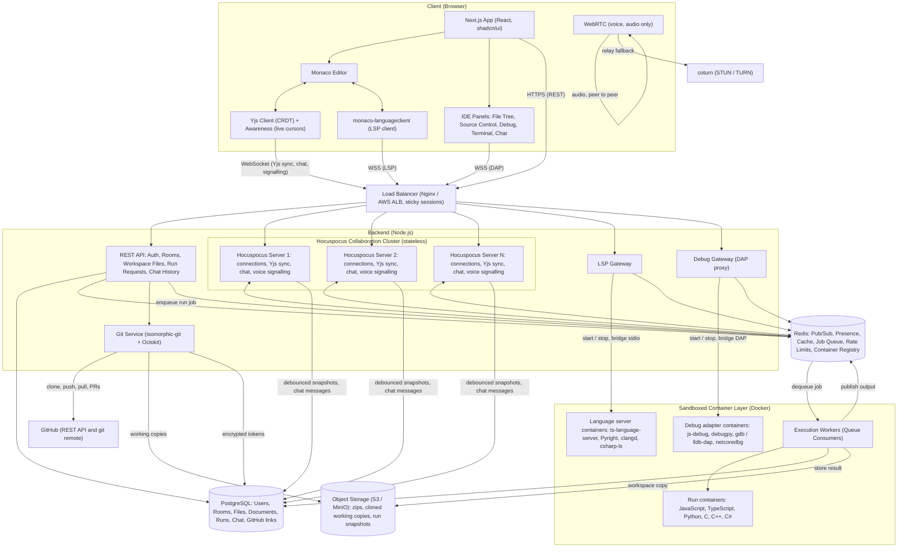
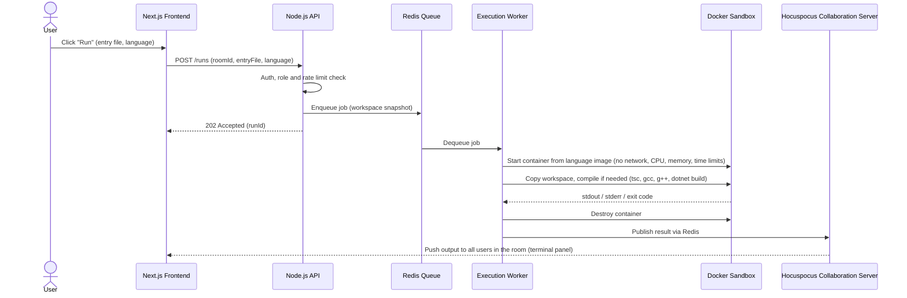
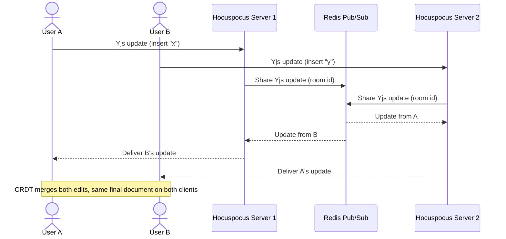
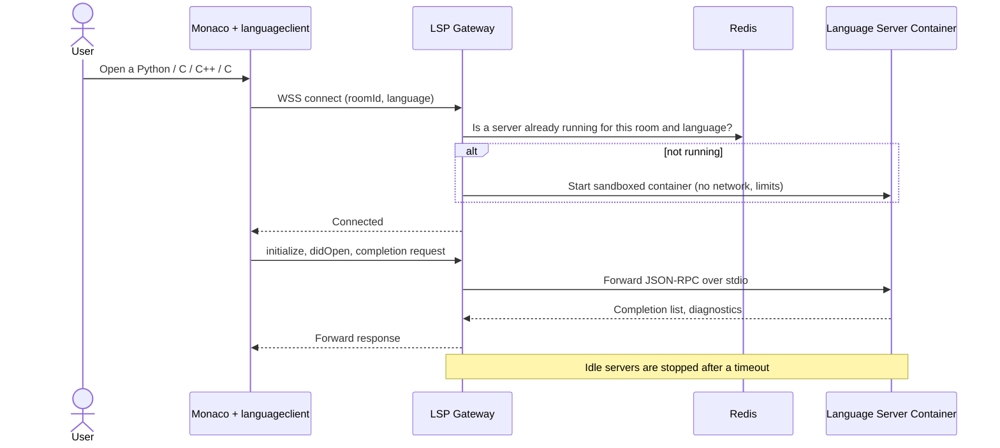
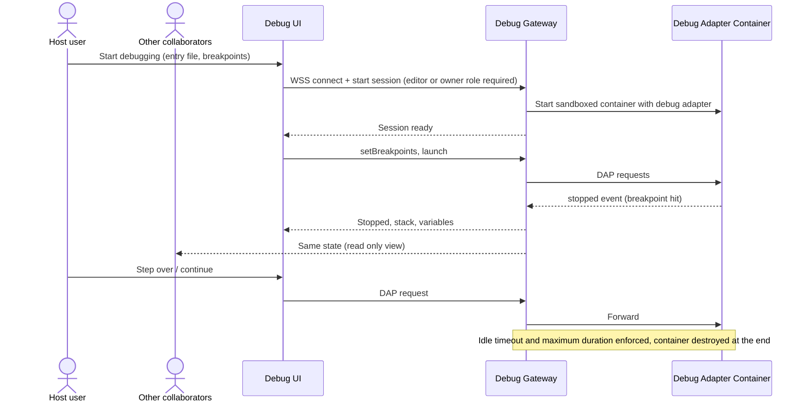
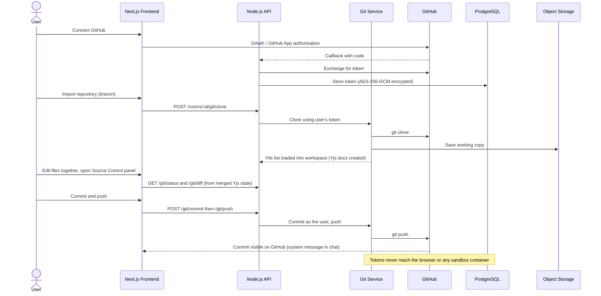
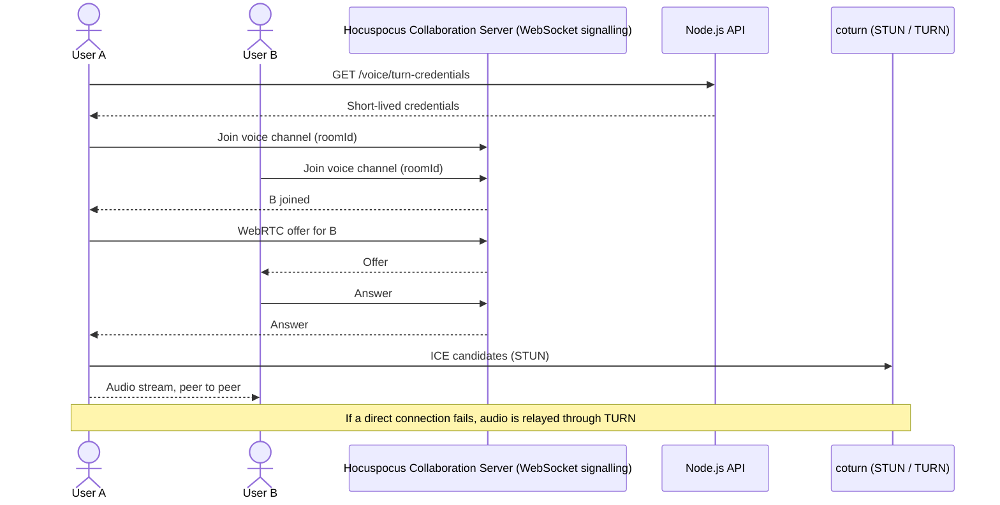
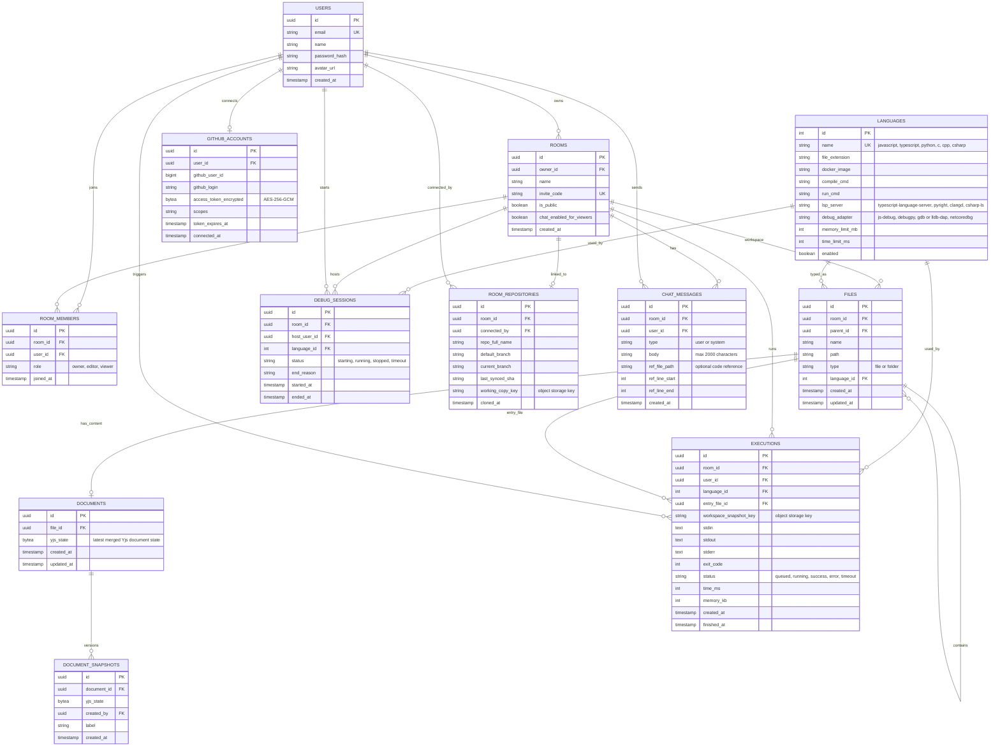
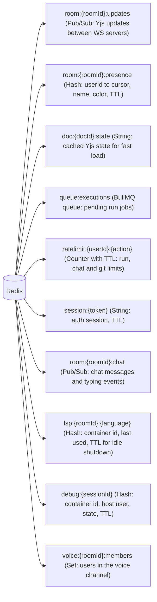

# Real-Time Collaborative Code Editor: Architecture (v1.2)

**Core stack:** Next.js (React, shadcn/ui, Tailwind CSS), Node.js (JavaScript), WebSockets, Yjs (CRDT), Hocuspocus, Redis, PostgreSQL, Docker
**IDE features:** Monaco, Language Server Protocol, Debug Adapter Protocol, GitHub (Octokit, isomorphic-git), WebRTC voice, text chat

---

## 1. System Architecture

### Code Execution Flow (multi-file project)

### Concurrent Edit Flow (CRDT)

### Language Server Flow (LSP)

### Debugging Flow (DAP)

### GitHub Flow (import, commit, push)

### Voice Chat Flow (WebRTC)

---

## 2. Database Architecture

### Redis Data Structures (not tables, in-memory)

---

## 3. Supported Languages

**Total: 6 languages.** Only these six can be run, and all six get the full IDE feature set (run, language server and debugger). Monaco can still highlight other file types, but they cannot be run or debugged.

| Language | Docker image | Compile / run | Language server | Debugger |
|---|---|---|---|---|
| JavaScript | node (LTS) | node file.js | typescript-language-server | vscode-js-debug |
| TypeScript | node with tsc | tsc, then node (or ts-node) | typescript-language-server | vscode-js-debug with source maps |
| Python | python 3 | python file.py | Pyright | debugpy |
| C | gcc | gcc with -g, then run | clangd | gdb (DAP mode) or lldb-dap |
| C++ | gcc (g++) | g++ with -g, then run | clangd | gdb (DAP mode) or lldb-dap |
| C# | .NET SDK (mcr.microsoft.com/dotnet/sdk) | dotnet build, then dotnet run | csharp-ls (Roslyn based) or OmniSharp | netcoredbg |

Adding another language later only needs a new row in the `LANGUAGES` table plus its container images.

---

## Design Notes

- **CRDT (Yjs):** edits merge automatically, so there is no central locking and offline edits sync after reconnect. Every file is its own Yjs document, and the folder tree is a shared Yjs map.
- **Collaboration layer:** WebSockets transport messages, Yjs manages shared documents and merges concurrent changes, and Hocuspocus coordinates connections and Yjs synchronization. Stateless Hocuspocus servers scale behind the load balancer; Redis Pub/Sub keeps instances in sync for edits, chat and voice signalling.
- **Debounced persistence:** the Yjs state is saved to PostgreSQL every few seconds, not on every keystroke.
- **Isolated execution:** each run uses a short-lived container (no network, read-only filesystem, non-root, CPU / memory / time limits) that is destroyed after the run.
- **Language servers and debuggers:** use the same standards as VS Code (LSP and DAP), run in sandboxed containers started on demand, are shared by the room, and stop after an idle timeout.
- **GitHub:** tokens are encrypted at rest and stay on the Git service. They are never sent to the browser or any sandbox container. Commits are made from the merged Yjs state and authored as the user who commits.
- **Chat and voice:** chat travels over the existing WebSocket and is stored in PostgreSQL. Voice is audio only over WebRTC (peer to peer for up to 6 users, TURN fallback) and is never recorded.
- **C# and C/C++ builds:** these need a compile step before running, so their run containers get a longer build time limit than interpreted languages. The .NET SDK image is large (several hundred MB), so it should be pre-pulled on execution hosts and warm containers kept ready to avoid slow first runs.
- **No network in the sandbox:** only the standard library and packages pre-installed in each language image are available, so there is no npm install, pip install or NuGet restore at run time. Commonly used packages should be baked into the images.
- **Separate scaling:** execution workers, language server containers and debug containers scale independently from the editing servers.